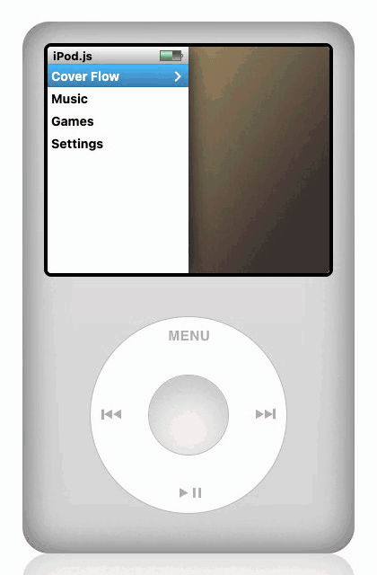
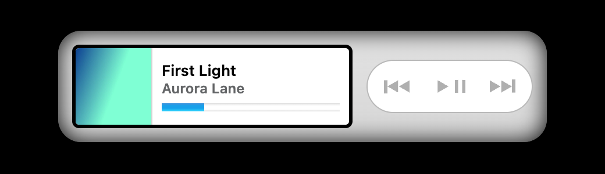
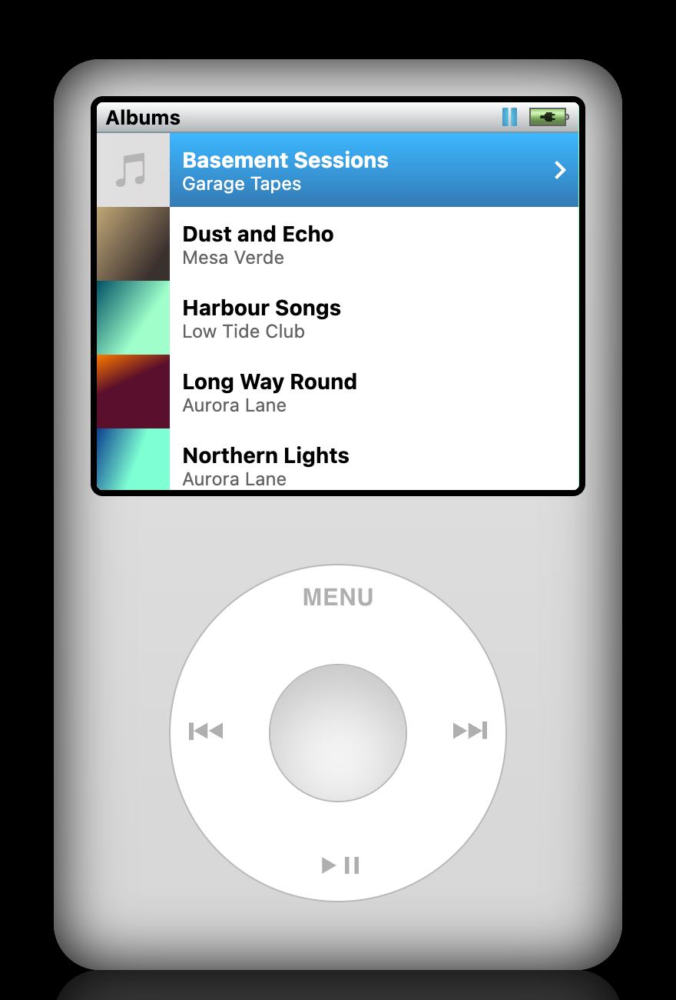
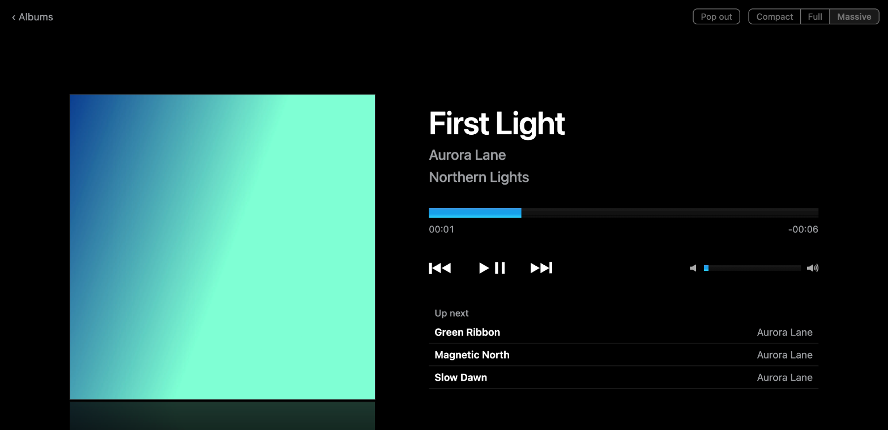

<div align="center">


# iPod.js (local files)

**The iPod Classic, playing the music on your own computer.**

[Your music](#your-music) · [Display modes](#display-modes) · [Running it yourself](#running-it-yourself)




</div>

Point it at a music folder and browse it with the click wheel. Nothing is uploaded: files are read straight from disk in the browser.

A reworking of [tvillarete/ipod-classic-js](https://github.com/tvillarete/ipod-classic-js) with the Apple Music and Spotify integrations replaced by a library read from a local folder.

<!-- live-links -->
**Live:** [gitguy268.github.io/ipod](https://gitguy268.github.io/ipod/) · [ipod-beige.vercel.app](https://ipod-beige.vercel.app)
<!-- /live-links -->

<!-- run-steps:start -->
## Run it locally, step by step

1. **Install [Node.js](https://nodejs.org) 22** or newer.

2. **Get the code:**

   ```sh
   git clone https://github.com/Gitguy268/ipod.git
   cd ipod
   ```

3. **Install [pnpm](https://pnpm.io/installation),** then the dependencies:

   ```sh
   pnpm install
   ```

4. **Start it:**

   ```sh
   pnpm dev
   ```

5. **Open <http://localhost:3000/ipod>** in your browser. Press `Ctrl+C` in the terminal to stop.
<!-- run-steps:end -->

## Your music

- Every audio file in the chosen folder and its subfolders is added: mp3, m4a, aac, flac, wav, ogg, opus, aiff.
- Artist, album, track, disc, genre and year come from the file tags. Files without tags fall back to `Artist/Album/01 Title.mp3` folder naming.
- Album artwork is read from the files. If a file has none, an image named `cover`, `folder`, `front` or `album` (jpg, png, webp) in the same folder is used.
- `.m3u` and `.m3u8` playlists in the folder show up under Playlists.
- Tags and artwork thumbnails are cached in the browser, so only new or changed files are read on later visits.
- Formats the browser can't play (Apple Lossless in Chrome and Firefox, WMA anywhere) are left out. Settings → Library says how many.

Choose the folder from the iPod's menu or the button at the top of the page, or drag it onto the window.

### Browser support

| Browser | Folder access |
|---|---|
| Chrome, Edge | The folder is remembered. On a later visit, one click re-allows it. |
| Safari, Firefox, Brave | The folder has to be chosen or dragged in again on each visit. When choosing, the browser words this as an "upload", but nothing leaves the computer. |

Brave ships with the folder-remembering feature switched off. Its experimental settings (`brave://flags`) may offer a "File System Access API" switch that turns it on.

The page has to be served from `https://` or `localhost`. It does not work opened as a file.

## Display modes

Switch with the control in the top-right corner, or under Settings.

| Mode | What you get | |
|---|---|---|
| **Compact** | Artwork, title and previous / play / next. **Pop out** puts it in a small window that stays above other apps (in Chrome, Edge and Brave; elsewhere it is an ordinary pop-up). |  |
| **Full** | The iPod. |  |
| **Massive** | Fills the window with the album cover, an album's track list, or a searchable wall of covers. |  |

## Playback

- Keyboard media keys and the system's now-playing panel control playback.
- After a reload, the song you were on is put back, paused where you left it.
- In Compact and Massive, Space plays and pauses and the left and right arrow keys change song.
- Hold the centre button on a song or album for Play Next and Play Later.

## Running it yourself

You need [Node.js](https://nodejs.org) (the version in `.tool-versions`) and [pnpm](https://pnpm.io).

```bash
pnpm install
pnpm dev
```

Then open **<http://localhost:3000/ipod>**.

To build the static site:

```bash
pnpm build
```

This writes it to `out/`. It expects to be served from the `/ipod` path, which is where a GitHub repository named `ipod` lands on GitHub Pages. To preview the build locally, copy `out/` into a folder as `ipod/` and serve that folder with any static file server.

Pushing to `main` deploys to GitHub Pages through `.github/workflows/deploy.yml`.

## Contributing

See [CONTRIBUTING.md](CONTRIBUTING.md) for how to set up, test and send changes, and [SECURITY.md](SECURITY.md) for reporting security problems.

## Credits

- The iPod interface, games and themes are from [iPod.js](https://github.com/tvillarete/ipod-classic-js) by Tanner Villarete (MIT).
- Tags and artwork are read with [music-metadata](https://github.com/Borewit/music-metadata) (MIT).
- The MilkDrop visualizer is [butterchurn](https://github.com/jberg/butterchurn) with [butterchurn-presets](https://github.com/jberg/butterchurn-presets), both by Jordan Berg (MIT). The presets are community MilkDrop presets, each named after its authors.
- The Bars visualizer follows [Musializer](https://github.com/tsoding/musializer) (MIT, copyright 2023 Alexey Kutepov and Musializer Contributors): its spectrum analysis and drawing, rewritten for the browser.
- Built with Next.js, React, TypeScript, styled-components, Motion, TanStack Query and Serwist.
- The images in `public/` come from the original project, except `card_back.svg`. The React logo shown in Settings is a trademark of Meta.

iPod is a trademark of Apple Inc. This project is a fan-made tribute and is not affiliated with or endorsed by Apple.

## License

[MIT](LICENSE)
